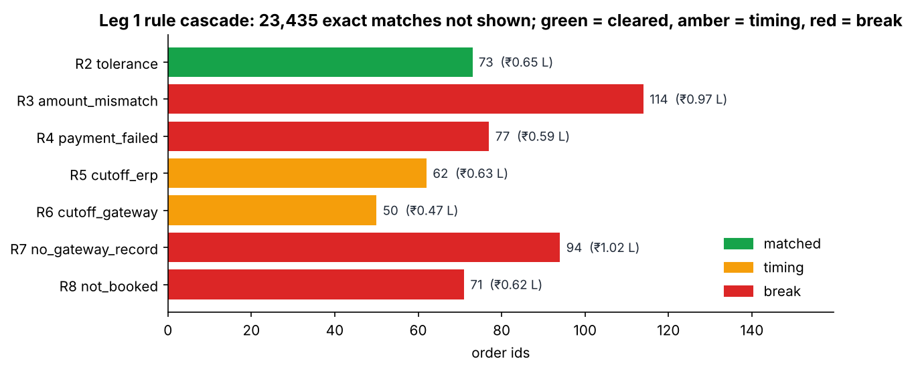
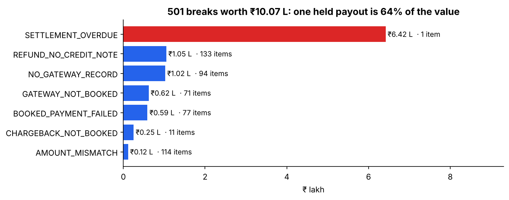
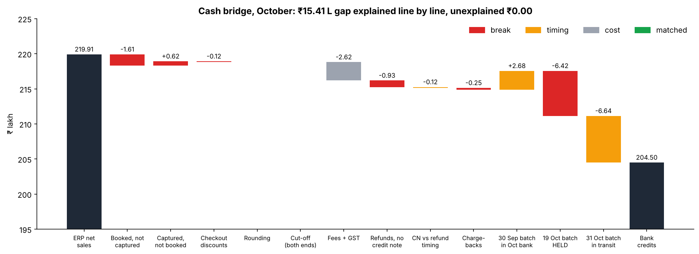
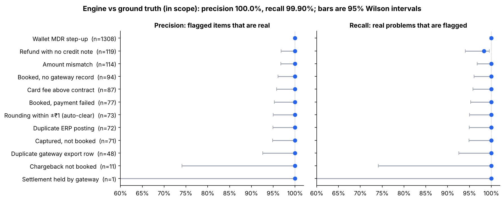
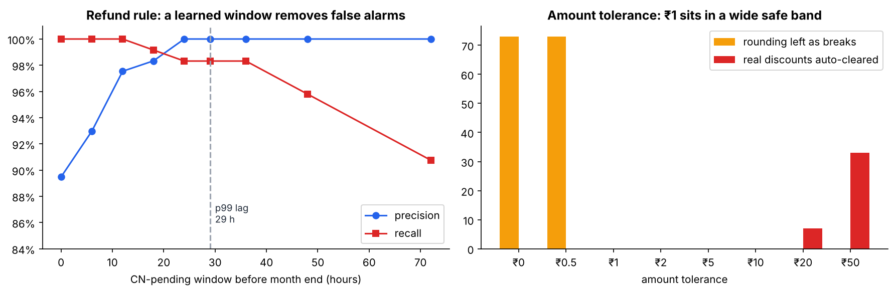
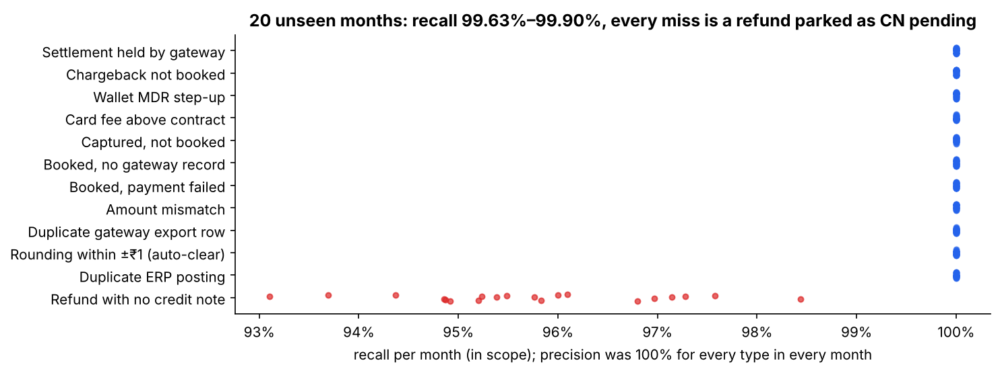

# Transaction Reconciliation Engine

Three-way month-end reconciliation for an online retailer: **ERP ledger ↔ payment gateway ↔ bank statement**, with rule-based matching, exception reporting and a finance dashboard.

> Status: **in progress** (week of 23–29 Nov 2026). Day 4 of 7: data, cleaning, EDA, the SQL matching engine and its validation against ground truth are done. The dashboard follows.

## The business problem

A mid-size Indian D2C retailer takes almost all of its revenue online through a payment gateway. At every month end the finance team has to prove three things before the books close:

1. **Every sale booked in the ERP was actually paid for** (and every payment received was booked).
2. **The gateway paid us what it owed** — gross captures minus the *contracted* fee, GST on that fee, refunds and chargebacks.
3. **That money actually arrived in the bank.**

Today this is done by hand in Excel with VLOOKUPs over ~25,000 rows, takes three to four days, and still leaves an unexplained difference that gets written off. The goal of this project is an engine that matches the three sources automatically, explains every rupee of difference by cause, and hands the team a short exception list to work instead of the full dataset.

**Questions the finance controller wants answered**

- How much of October's ledger revenue is *not* backed by a gateway capture, and why?
- Are we being charged the contracted MDR (fee) on every payment method?
- Which refunds and chargebacks have hit our payouts but are missing from the books?
- Which settlements have not reached the bank, and is that timing or a real problem?

## Data

The sources are synthetic but built to look like real exports, including the problems that make reconciliation hard. They are generated by a seeded script so every number here is reproducible. See [`docs/data_dictionary.md`](docs/data_dictionary.md) for every column.

| File | Rows | What it is |
|---|---:|---|
| `erp_ledger.csv` | 24,261 | Sales receipts and credit notes (IST, three date formats, text amounts) |
| `gateway_txns.csv` | 24,298 | Gateway transaction report (UTC, amounts in paise, messy order refs) |
| `gateway_payouts.csv` | 32 | Daily settlement batches with fees, GST, refunds, chargebacks |
| `bank_statement.csv` | 111 | Current-account statement for October |

### Assumptions behind the generator
- ~25k online orders between 30 Sep 18:00 and 1 Nov 08:00 IST; order value log-normal (median about ₹700, capped ₹99–₹25,000); evening peak with some late-night traffic so the month boundary matters.
- Payment mix: UPI 55%, Card 25%, NetBanking 10%, Wallet 10%. **Contracted MDR**: UPI 0.30%, Card 1.90%, NetBanking 1.50%, Wallet 2.00%, plus 18% GST on the fee.
- The gateway settles each IST day's captures net of fees, GST, refunds and chargebacks on the next business day (no Sunday credits).
- The ERP books in **IST**; the gateway report is pulled by **UTC** date — a real and common cut-off trap.

### Problems injected (and labelled for scoring later)
| Problem | Rate / count |
|---|---|
| Booked in ERP, no gateway record | 0.4% of orders |
| Booked in ERP, gateway payment **failed** | 0.3% |
| Gateway captured less than booked (coupon applied at checkout) | 0.5% |
| ±₹1 rounding differences (should be tolerated) | 0.4% |
| Captured at gateway, never booked | 0.3% |
| Duplicate ERP postings / duplicate gateway export rows | 0.3% / 0.2% |
| Refunds processed, 30% with no credit note in the ERP | 2% of captures |
| Card payments charged 2.4% instead of 1.9% | 1.5% of card txns |
| Wallet MDR silently raised to 2.25% from 15 Oct | all wallet txns from that date |
| Chargebacks deducted from payouts | 15 |
| One settlement held by the gateway (credited 3 Nov) | 1 batch |

The ground-truth file `data/truth/labels.csv` is only used to score the engine; the engine never reads it.

## Pipeline

```
src/generate_data.py   -> data/raw/*.csv, data/truth/labels.csv
src/clean.py           -> data/clean/*.parquet, dq_log.csv, validation_report.csv
src/match.py           -> runs sql/*.sql in DuckDB -> data/output/ (matches, exception register, cash bridge)
src/score.py           -> engine vs data/truth/labels.csv -> data/output/scorecard.csv, score_detail.csv
src/robustness.py      -> whole pipeline on 20 regenerated months -> data/output/robustness.csv
notebooks/01_data_quality.ipynb
notebooks/02_eda.ipynb
notebooks/03_sql_engine.ipynb
notebooks/04_validation.ipynb -> images/*.png
src/run_notebooks.py   executes every notebook in place (nbclient)
```

Run everything: `pip install -r requirements.txt && ./run_all.sh`

### Cleaning (18 logged rules, 19/19 validation checks pass)
Every rule writes how many rows it touched to `data/clean/dq_log.csv`; removed rows go to `quarantine.parquet` with a reason.

| Rule | Rows |
|---|---:|
| Parse three ERP timestamp formats | 7,265 |
| Strip thousands separators from text amounts | 1,165 |
| Blank payment mode (manual journals) → `Unknown` | 129 |
| Remove ERP test postings | 40 |
| Remove duplicate ERP postings | 72 |
| Remove duplicate gateway export rows | 48 |
| Normalise gateway merchant refs (`ord-…`, ` ORD… `, `ORD_…`) | 4,778 |
| UTC → IST (rows whose date changes) | 1,725 |
| Gateway rows that are 1 Nov in IST (out of period) | 53 |
| Failed gateway attempts | 77 |
| Settlements carrying chargebacks | 11 |

Validation checks include: unique keys, every order id matching `ORD-nnnnnnn`, GST = 18% of fee to the paisa, payout net = gross − fee − GST − refunds − chargebacks, payout gross = sum of the gateway's captured transactions for 30 batches, and the bank running balance recomputing exactly.

## Findings so far (Day 2, from `notebooks/02_eda.ipynb`)

**Control totals don't tie.** October ERP net sales are ₹2,19,91,231.50; PayFlux credits in the bank are ₹2,04,49,800.31 — a gap of **₹15,41,431.19**. That gap mixes fees, timing and real breaks; the work below starts pulling them apart.


**1. A plain order-id join gets 97.7% of the way.** 23,435 of 23,976 order ids match exactly. 73 more differ by ±₹1 (net −₹1; a tolerance rule should clear them). That leaves **468 keys worth ₹4.30 L** that need a decision.


**2. 112 of the 277 "missing" rows are a report-extraction artefact.** The ERP books in IST but the gateway report was pulled by UTC date. 62 of the 156 ERP-only rows (₹0.63 L) were posted on 1 Oct between 00:00 and 05:30 IST, which is still 30 Sep in UTC. 50 of the 121 gateway-only rows (₹0.47 L) are 1 Nov in IST. Fix: pull the report by IST date, and treat rows within 5½ hours of a month boundary as *timing*, not *breaks*.

**3. Every amount difference above ₹1 is an under-collection.** In all 114 cases the gateway collected 5.2%–19.9% less than the ERP booked (median 12.3%, ₹0.12 L in total). It's one-directional and sized like a coupon, so it points to discounts applied at checkout after the ERP order was created. That's a process gap, not keying noise.


**4. The gateway charges above contract.** Wallet MDR moved from 2.000% to **2.250% on 15 Oct**, with no contract change (1,308 wallet transactions affected). 87 of 5,920 card payments (1.47%) were charged **2.40%** instead of 1.90%. The October excess is ₹3,955 including GST. That's small in rupees, but it's a control failure that compounds every month, and nobody would see it without a per-transaction fee check.

**5. Money left through refunds and chargebacks that the books don't show.** 133 of 427 October refunds (31%, ₹1.05 L) have no ERP credit note. Chargebacks of ₹0.25 L were netted out of 11 payouts, with no ERP entry.


**6. Two settlements are not in the October bank statement.** The 31 Oct batch (₹6,64,381.60) is in transit, which is normal timing. The **19 Oct batch (₹6,41,741.68)** was due on 20 Oct and was paid only on 3 Nov (T+15). It was held by the gateway and needs a follow-up and an aged receivable.

**7. Breaks are not concentrated in one payment method or channel.** Chi-square tests of break rate (excluding the cut-off window) give p = 0.200 for payment method and p = 0.317 for channel. The causes look like process (manual bookings, discounts, unposted refunds), not one faulty integration.

## The SQL engine (Day 3, `sql/` + `notebooks/03_sql_engine.ipynb`)

The matching rules are plain SQL files run in order by DuckDB, so finance can read and change them without touching Python. The engine reads only `data/clean/`, never the truth labels.

| File | Job | Techniques |
|---|---|---|
| `00_staging.sql` | typed views, period/tolerance parameters, contracted MDR table | parameter table, `REPLACE` casts |
| `10_ledger_vs_gateway.sql` | leg 1 rule cascade (R0–R9) + probable-pair diagnostic | `FULL OUTER JOIN`, ordered `CASE`, mutual-best `ROW_NUMBER()` |
| `20_refunds_chargebacks.sql` | refunds ↔ credit notes (with a learned CN-pending window), chargebacks | `LEFT` / `ANTI JOIN`, `QUANTILE_CONT` |
| `30_fee_audit.sql` | every capture re-priced at contract; daily effective rate | `LAG()`, running `SUM() OVER` |
| `40_settlement_vs_bank.sql` | leg 2 payout rebuilt from its transactions (many-to-one); leg 3 payout ↔ bank by UTR | `FILTER` aggregates, due-date logic, running-balance window |
| `50_exception_register.sql` | one register: owner, action, age, rank in type, Pareto share | `UNION ALL`, `RANK()`, cumulative window |
| `60_cash_bridge.sql` | ERP net sales → bank credits, line by line | running total, residual line |

`python src/match.py` runs it and checks 7 integrity rules (every row gets exactly one outcome on every leg, payouts rebuild from transactions, no orphan bank credits, bank balance recomputes, bridge residual ≤ ₹1). **7/7 pass.**

**Leg 1 rule cascade** (one outcome per order id, first matching rule wins)

| Rule | Outcome | Keys | Value |
|---|---|---:|---:|
| R0 booked 31 Oct, captured 1 Nov (added Day 4) | timing | 0 | ₹0 |
| R1 exact | matched | 23,435 | ₹2,18,28,252 |
| R2 within ±₹1 | matched | 73 | ₹65,024 |
| R3 amount mismatch | break | 114 | ₹97,315 |
| R4 booked, payment failed | break | 77 | ₹58,982 |
| R5 cut-off, ERP side (1 Oct before 05:30 IST) | timing | 62 | ₹63,347 |
| R6 cut-off, gateway side (1 Nov IST) | timing | 50 | ₹46,656 |
| R7 booked, no gateway record | break | 94 | ₹1,02,268 |
| R8 captured, not booked | break | 71 | ₹61,929 |



- **98.05% of 23,976 keys auto-match** (Day 2's exact join: 97.74%). The 112 cut-off rows move to *timing*, leaving **356 leg-1 breaks worth ₹3.20 L**.
- A mutual-best search for mistyped order ids (same amount and method, within 10 minutes) found **0 probable pairs**, so the one-sided rows are real omissions.
- `LAG()` over daily effective rates finds the **wallet MDR step on 15 Oct (2.00% → 2.25%)** with no date hard-coded. Fee excess above contract: ₹3,445.15 on 1,308 wallet and ₹508.01 on 87 card transactions (incl. GST).
- **30 of 32 payouts rebuild exactly** from their transactions (gross, fee, GST, refunds). The two that don't are the 30 Sep and 1 Oct batches, whose early captures fall outside the UTC-dated export.

**Exception register: 619 items** (`data/output/exception_register.csv`, after the Day 4 refund fix)

| Class | Type | Owner | Items | ₹ impact |
|---|---|---|---:|---:|
| break | Settlement overdue (19 Oct batch) | Treasury | 1 | 6,41,741.68 |
| break | Refund with no credit note | Finance (AR) | 117 | 92,726.50 |
| break | Booked, no gateway record | Finance (AR) | 94 | 1,02,268.00 |
| break | Captured, not booked | Finance (GL) | 71 | 61,929.00 |
| break | Booked, payment failed | Finance (AR) | 77 | 58,982.00 |
| break | Chargeback not booked | Finance (AR) | 11 | 25,150.00 |
| break | Amount mismatch (checkout discount) | E-commerce ops | 114 | 11,553.00 |
| claim | Fee above contract (2 methods, 1,395 txns) | Treasury / vendor manager | 2 | 3,953.16 |
| timing | Settlement in transit (31 Oct) | Treasury | 1 | 6,64,381.60 |
| timing | Cut-off window | Finance (GL) | 115 | 1,13,626.50 |
| timing | Refund, credit note pending (added Day 4) | Finance (AR) | 16 | 12,348.50 |



The 485 breaks total ₹9.94 L, and the single held payout is 64.5% of that. 66 items cover 80% of the break value, so a reviewer can clear most of the money by working the top of the list. A `QUALIFY ROW_NUMBER() OVER (PARTITION BY owner …) <= 3` query gives each owner a starting queue.

**Cash bridge: the ₹15.41 L gap explained to ₹0.00**

| Step | ₹ |
|---|---:|
| ERP net sales, October | 2,19,91,231.50 |
| Booked but never captured (no record / failed) | −1,61,250.00 |
| Captured but never booked | +61,929.00 |
| Checkout discounts not passed to ERP | −11,553.00 |
| Rounding within ±₹1 | −1.00 |
| Cut-off: unexported 1 Oct captures not in ERP; 31 Oct bookings captured 1 Nov | +256.00 |
| Gateway fees and GST on fees | −2,62,236.51 |
| Refunds netted with no credit note | −92,726.50 |
| Credit-note vs refund timing (incl. 16 CN-pending refunds) | −12,348.50 |
| Chargebacks netted, not booked | −25,150.00 |
| 30 Sep batch credited on 1 Oct | +2,67,772.60 |
| 19 Oct batch held by gateway | −6,41,741.68 |
| 31 Oct batch in transit | −6,64,381.60 |
| **Unexplained** | **0.00** |
| PayFlux credits in October bank statement | 2,04,49,800.31 |



The ₹256 cut-off line is money inside the 1 Oct payout that sits outside the UTC export and isn't in the ERP's cut-off rows either: most likely unbooked captures from 1 Oct 00:00–05:30 IST. It can only be pinned to orders once the report is re-pulled by IST date.

## Validation against ground truth (Day 4, `src/score.py` + `notebooks/04_validation.ipynb`)

The generator labels every problem it injects; the engine never reads those labels. Scoring compares what the engine flagged with what was really broken, per exception type, on the business key each problem is reported on (order id, gateway txn id or settlement id). Two views are kept: **raw** (every label) and **in scope** (drops labels on activity that isn't October-IST activity or isn't in the files finance received, such as a wallet overcharge on a 1 Nov capture, which the engine correctly sends to next period). Every dropped label is listed with its reason in `data/output/score_detail.csv`.

| | Labelled | Flagged | False positives | Misses | Precision | Recall |
|---|---:|---:|---:|---:|---:|---:|
| **In scope** | 2,075 | 2,073 | 0 | 2 | **100%** (95% CI 99.82–100%) | **99.90%** (95% CI 99.65–99.97%) |
| Raw | 2,109 | 2,073 | 0 | 36 | 100% | 98.29% |

Precision is 100% on all 12 exception types. Recall in scope is 100% on 11 of them; refunds are at 98.32% (117 of 119).



**Scoring found two engine bugs, both now fixed in SQL**

1. **Refunds on 31 Oct were false breaks.** The Day 3 rule flagged 133 refunds with no credit note; 14 were wrong (precision 89.47%), and all 14 were 31 Oct refunds whose credit note finance correctly posted in November. New rule **F5 CN pending**: a refund with no credit note yet, made within the usual posting lag of month end, is timing. The lag is learned from the 294 matched refund ↔ credit-note pairs (median 14.0 h, p99 29.0 h), not typed in. Result: 0 false positives, 16 refunds parked as pending, 2 of which are real breaks that get re-checked in early November.
2. **A booking on 31 Oct captured on 1 Nov matched as "exact".** Its cash is in the November payout, so the cash bridge was left with an unexplained line. It never happened in the published month; the robustness run below found it on 7 of 20 other months (residuals of ₹376–₹2,668). New rule **R0 cross-period** sends these to timing.

**The judgement calls are not fragile**



- **CN-pending window:** any window from 24 h to 36 h gives the same result (precision 100%, recall 98.32%). Shorter brings false alarms back (12 h: 3 false positives); longer parks real breaks (72 h: recall 90.76%).
- **Amount tolerance:** the largest rounding difference is ₹1.00 and the smallest real checkout discount is ₹13.00, so any tolerance from ₹1 up to just under ₹13 gives a perfect split. At ₹20, 7 real discounts would be auto-cleared.

**Robustness: 20 months the rules have never seen**

`src/robustness.py` regenerates the month with seeds 101–120 (same rates; different orders, amounts, timings and broken rows) and runs cleaning → engine → integrity checks → scoring with the rules frozen.

| Across 20 months | Result |
|---|---|
| Integrity checks (7 per month) | all pass |
| Cash bridge unexplained | ₹0.00 in every month |
| Precision (in scope) | 100% for every type in every month |
| Recall (in scope) | 99.63% – 99.90% (mean 99.75%) |
| Misses | 106 of 42,449 labels, **all** refunds parked as CN pending |



**What this means for finance:** nothing on the work list is a false alarm, and nothing real is dropped silently; the only misses sit in a short "check in early November" queue. Most out-of-scope labels exist only because the gateway report is pulled by UTC date, so pulling it by IST date is the one process fix that removes them.

## Repository layout
```
data/raw/        source exports (generated)
data/clean/      cleaned tables, DQ log, validation report, quarantine
data/output/     engine outputs: leg matches, fee audit, exception register, cash bridge, scorecard, robustness
data/truth/      injected-problem labels (scoring only)
docs/            data dictionary
notebooks/       executed notebooks
images/          charts used in this README
sql/             the matching engine (DuckDB), run in file order
src/             generator, cleaning pipeline, engine runner, notebook runner
```

## Roadmap
- [x] Day 1 — problem, data dictionary, generator, cleaning pipeline with validation
- [x] Day 2 — EDA and first findings
- [x] Day 3 — SQL (DuckDB) engine: rule cascade, fee audit, payout rebuild, exception register, cash bridge
- [x] Day 4 — engine scored against ground truth: precision/recall per type, error analysis, rule sensitivity, 20-month robustness
- [ ] Day 5 — reconciliation dashboard
- [ ] Day 6 — ₹ impact, recommendations, case study
- [ ] Day 7 — final write-up and fresh-clone check
