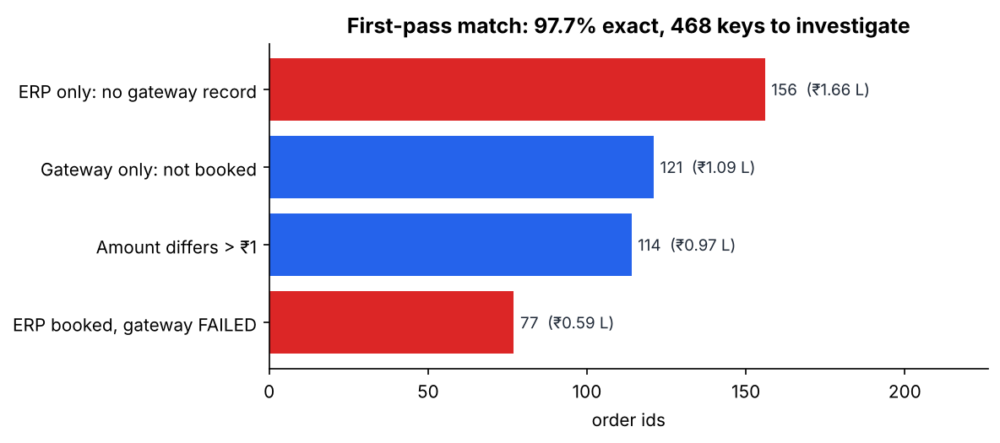
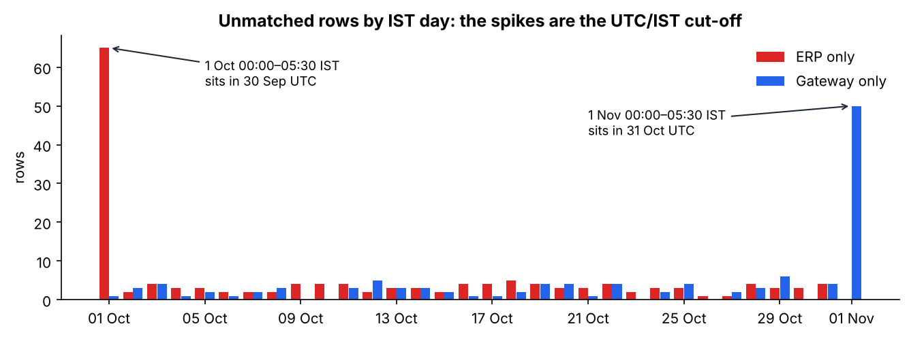
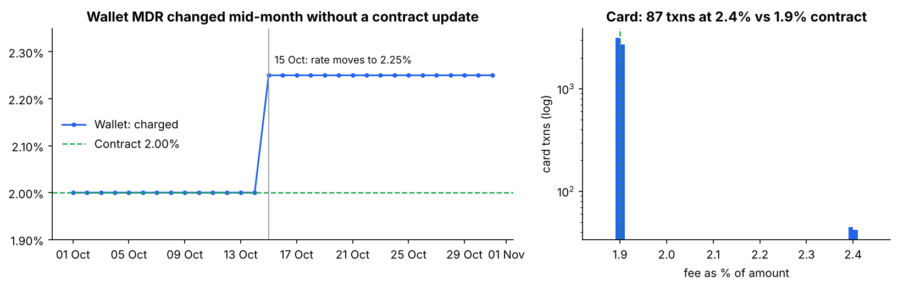
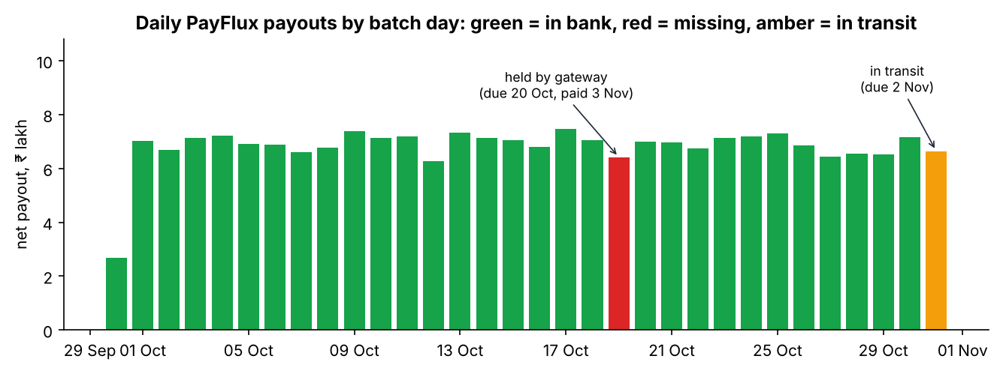

# Transaction Reconciliation Engine

Three-way month-end reconciliation for an online retailer: **ERP ledger ↔ payment gateway ↔ bank statement**, with rule-based matching, exception reporting and a finance dashboard.

> Status: **in progress** (week of 23–29 Nov 2026). Day 2 of 7: data, cleaning pipeline and EDA are done. SQL matching, validation against ground truth and the dashboard follow.

## The business problem

A mid-size Indian D2C retailer takes almost all of its revenue online through a payment gateway. At every month end the finance team has to prove three things before the books close:

1. **Every sale booked in the ERP was actually paid for** (and every payment received was booked).
2. **The gateway paid us what it owed** — gross captures minus the *contracted* fee, GST on that fee, refunds and chargebacks.
3. **That money actually arrived in the bank.**

Today this is done by hand in Excel with VLOOKUPs over ~25,000 rows, takes three to four days, and still leaves an unexplained difference that gets written off. The goal of this project is an engine that matches the three sources automatically, explains every rupee of difference by cause, and hands the team a short exception list to work instead of the full dataset.

**Questions the finance controller wants answered**

- How much of October's ledger revenue is *not* backed by a gateway capture, and why?
- Are we being charged the contracted MDR (fee) on every payment method?
- Which refunds and chargebacks have hit our payouts but are missing from the books?
- Which settlements have not reached the bank, and is that timing or a real problem?

## Data

The sources are synthetic but built to look like real exports, including the problems that make reconciliation hard. They are generated by a seeded script so every number here is reproducible. See [`docs/data_dictionary.md`](docs/data_dictionary.md) for every column.

| File | Rows | What it is |
|---|---:|---|
| `erp_ledger.csv` | 24,261 | Sales receipts and credit notes (IST, three date formats, text amounts) |
| `gateway_txns.csv` | 24,298 | Gateway transaction report (UTC, amounts in paise, messy order refs) |
| `gateway_payouts.csv` | 32 | Daily settlement batches with fees, GST, refunds, chargebacks |
| `bank_statement.csv` | 111 | Current-account statement for October |

### Assumptions behind the generator
- ~25k online orders between 30 Sep 18:00 and 1 Nov 08:00 IST; order value log-normal (median about ₹700, capped ₹99–₹25,000); evening peak with some late-night traffic so the month boundary matters.
- Payment mix: UPI 55%, Card 25%, NetBanking 10%, Wallet 10%. **Contracted MDR**: UPI 0.30%, Card 1.90%, NetBanking 1.50%, Wallet 2.00%, plus 18% GST on the fee.
- The gateway settles each IST day's captures net of fees, GST, refunds and chargebacks on the next business day (no Sunday credits).
- The ERP books in **IST**; the gateway report is pulled by **UTC** date — a real and common cut-off trap.

### Problems injected (and labelled for scoring later)
| Problem | Rate / count |
|---|---|
| Booked in ERP, no gateway record | 0.4% of orders |
| Booked in ERP, gateway payment **failed** | 0.3% |
| Gateway captured less than booked (coupon applied at checkout) | 0.5% |
| ±₹1 rounding differences (should be tolerated) | 0.4% |
| Captured at gateway, never booked | 0.3% |
| Duplicate ERP postings / duplicate gateway export rows | 0.3% / 0.2% |
| Refunds processed, 30% with no credit note in the ERP | 2% of captures |
| Card payments charged 2.4% instead of 1.9% | 1.5% of card txns |
| Wallet MDR silently raised to 2.25% from 15 Oct | all wallet txns from that date |
| Chargebacks deducted from payouts | 15 |
| One settlement held by the gateway (credited 3 Nov) | 1 batch |

The ground-truth file `data/truth/labels.csv` is only used to score the engine; the engine never reads it.

## Pipeline

```
src/generate_data.py   -> data/raw/*.csv, data/truth/labels.csv
src/clean.py           -> data/clean/*.parquet, dq_log.csv, validation_report.csv
notebooks/01_data_quality.ipynb
notebooks/02_eda.ipynb -> images/*.png
src/run_notebooks.py   executes both notebooks in place (nbclient)
```

Run everything: `pip install -r requirements.txt && ./run_all.sh`

### Cleaning (18 logged rules, 19/19 validation checks pass)
Every rule writes how many rows it touched to `data/clean/dq_log.csv`; removed rows go to `quarantine.parquet` with a reason.

| Rule | Rows |
|---|---:|
| Parse three ERP timestamp formats | 7,265 |
| Strip thousands separators from text amounts | 1,165 |
| Blank payment mode (manual journals) → `Unknown` | 129 |
| Remove ERP test postings | 40 |
| Remove duplicate ERP postings | 72 |
| Remove duplicate gateway export rows | 48 |
| Normalise gateway merchant refs (`ord-…`, ` ORD… `, `ORD_…`) | 4,778 |
| UTC → IST (rows whose date changes) | 1,725 |
| Gateway rows that are 1 Nov in IST (out of period) | 53 |
| Failed gateway attempts | 77 |
| Settlements carrying chargebacks | 11 |

Validation checks include: unique keys, every order id matching `ORD-nnnnnnn`, GST = 18% of fee to the paisa, payout net = gross − fee − GST − refunds − chargebacks, payout gross = sum of the gateway's captured transactions for 30 batches, and the bank running balance recomputing exactly.

## Findings so far (Day 2, from `notebooks/02_eda.ipynb`)

**Control totals don't tie.** October ERP net sales are ₹2,19,91,231.50; PayFlux credits in the bank are ₹2,04,49,800.31 — a gap of **₹15,41,431.19**. That gap mixes fees, timing and real breaks; the work below starts pulling them apart.



**1. A plain order-id join gets 97.7% of the way.** 23,435 of 23,976 order ids match exactly. 73 more differ by ±₹1 (net −₹1; a tolerance rule should clear them). That leaves **468 keys worth ₹4.30 L** that need a decision.



**2. 112 of the 277 "missing" rows are a report-extraction artefact.** The ERP books in IST but the gateway report was pulled by UTC date. 62 of the 156 ERP-only rows (₹0.63 L) were posted on 1 Oct between 00:00 and 05:30 IST, which is still 30 Sep in UTC. 50 of the 121 gateway-only rows (₹0.47 L) are 1 Nov in IST. Fix: pull the report by IST date, and treat rows within 5½ hours of a month boundary as *timing*, not *breaks*.

**3. Every amount difference above ₹1 is an under-collection.** In all 114 cases the gateway collected 5.2%–19.9% less than the ERP booked (median 12.3%, ₹0.12 L in total). It's one-directional and sized like a coupon, so it points to discounts applied at checkout after the ERP order was created. That's a process gap, not keying noise.



**4. The gateway charges above contract.** Wallet MDR moved from 2.000% to **2.250% on 15 Oct**, with no contract change (1,308 wallet transactions affected). 87 of 5,920 card payments (1.47%) were charged **2.40%** instead of 1.90%. The October excess is ₹3,955 including GST. That's small in rupees, but it's a control failure that compounds every month, and nobody would see it without a per-transaction fee check.

**5. Money left through refunds and chargebacks that the books don't show.** 133 of 427 October refunds (31%, ₹1.05 L) have no ERP credit note. Chargebacks of ₹0.25 L were netted out of 11 payouts, with no ERP entry.



**6. Two settlements are not in the October bank statement.** The 31 Oct batch (₹6,64,381.60) is in transit, which is normal timing. The **19 Oct batch (₹6,41,741.68)** was due on 20 Oct and was paid only on 3 Nov (T+15). It was held by the gateway and needs a follow-up and an aged receivable.

**7. Breaks are not concentrated in one payment method or channel.** Chi-square tests of break rate (excluding the cut-off window) give p = 0.200 for payment method and p = 0.317 for channel. The causes look like process (manual bookings, discounts, unposted refunds), not one faulty integration.

## Repository layout
```
data/raw/        source exports (generated)
data/clean/      cleaned tables, DQ log, validation report, quarantine
data/truth/      injected-problem labels (scoring only)
docs/            data dictionary
notebooks/       executed notebooks
images/          charts used in this README
src/             generator, cleaning pipeline, notebook runner
```

## Roadmap
- [x] Day 1 — problem, data dictionary, generator, cleaning pipeline with validation
- [x] Day 2 — EDA and first findings
- [ ] Day 3 — SQL (DuckDB) matching: exact, normalised, tolerance and many-to-one rules
- [ ] Day 4 — engine scored against ground truth (precision / recall per exception type)
- [ ] Day 5 — reconciliation dashboard
- [ ] Day 6 — ₹ impact, recommendations, case study
- [ ] Day 7 — final write-up and fresh-clone check
