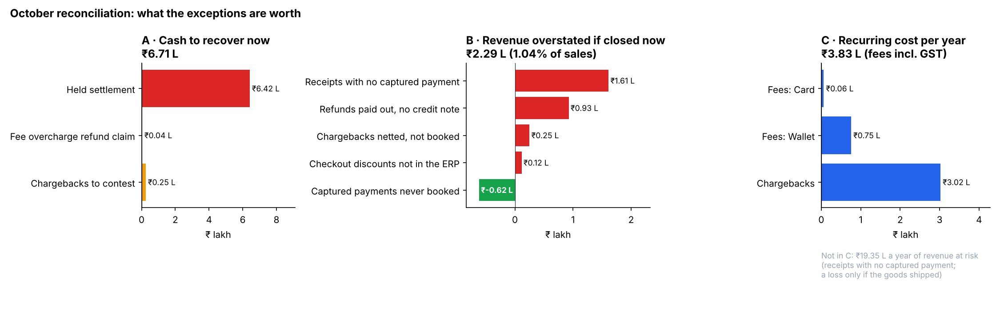
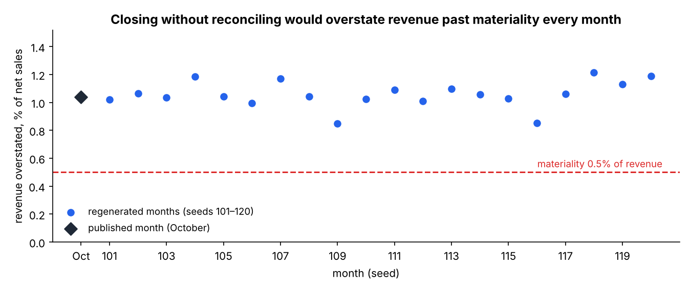
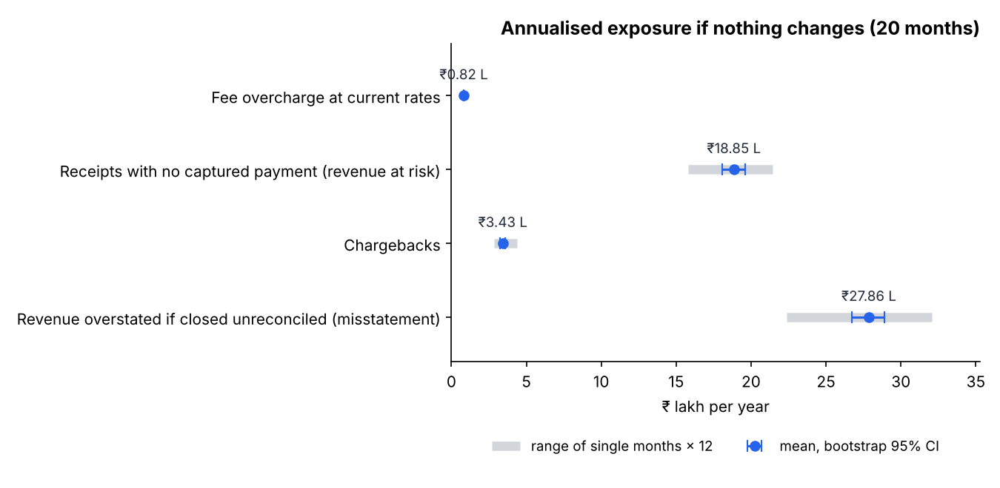
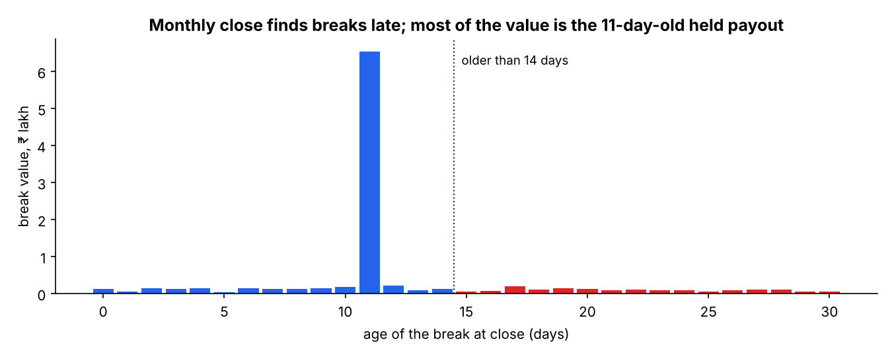

# October close: reconciliation findings and recommendations

**To:** Finance Controller · **From:** Data Analytics · **Period:** October 2026 (IST) · **Basis:** `notebooks/06_impact.ipynb`, `impact/impact.sql`

## In one paragraph

The engine reconciles ERP net sales of **₹2,19,91,231.50** to PayFlux credits in the bank of **₹2,04,49,800.31** with **₹0.00 unexplained**. Three things need a decision. **₹6.71 L of cash can be recovered now**, almost all of it one payout the gateway is holding. **If October closed without these adjustments, revenue would be overstated by ₹2.29 L (1.04% of sales)**, about twice a 0.5% materiality threshold, and the same happens in all 20 test months. And **two causes keep costing money every month**: receipts posted for orders that were never paid (₹1.61 L in October) and a wallet fee rate PayFlux raised without a contract change (about ₹0.81 L a year at the new rate).

## What the exceptions are worth

### A · Cash to recover now (one-off)

| Item | ₹ | Owner | Action |
|---|---:|---|---|
| 19 Oct settlement held by PayFlux (11 days overdue at close) | 6,41,741.68 | Treasury | Escalate; book a receivable from the gateway |
| Fees charged above contract (1,395 transactions) | 3,953.16 | Treasury / vendor manager | Claim with the `fee_audit` extract |
| Chargebacks netted from payouts (upper bound) | 25,150.00 | Finance (AR) | Contest where delivery proof exists |
| **Total** | **6,70,844.84** | | |

The held payout is 95.7% of this. It is owed, not lost, but until it is booked as a receivable the October cash position is understated by that amount.

### B · Revenue misstatement if October closed today

| Item | ₹ | Direction |
|---|---:|---|
| Receipts with no captured payment (no gateway record + payment failed) | 1,61,250.00 | overstated |
| Refunds paid out, no credit note | 92,726.50 | overstated |
| Chargebacks netted, not booked | 25,150.00 | overstated |
| Checkout discounts not passed to the ERP | 11,553.00 | overstated |
| Captured payments never booked | −61,929.00 | understated |
| **Net overstatement** | **2,28,750.50** | **1.040% of net sales** |

Against a performance-materiality threshold of 0.5% of revenue (₹1,09,956.16) this is 2.08× over, and it stays material for any threshold below 1.04%. On the 20 regenerated months the overstatement runs from 0.851% to 1.214% of sales (mean 1.059%): **material in 20 of 20**. No single item is large; the problem is that about 480 small items all point the same way.

### C · What it costs per year if nothing changes

| Line | October | Per year (October run rate) | 20-month mean, 95% CI |
|---|---:|---:|---:|
| Fee overcharge at current rates (Wallet ₹75,317.50 + Card ₹5,981.41) | ₹3,953.16 claimed | ₹81,298.91 | ₹82,307 (₹81,465 – ₹83,129) |
| Receipts with no captured payment (**revenue at risk**) | ₹1,61,250.00 | ₹19,35,000.00 | ₹18.85 L (₹18.08 – ₹19.60 L) |
| Chargebacks | ₹25,150.00 | ₹3,01,800.00 | ₹3.43 L (₹3.26 – ₹3.61 L) |
| Cost of funds on a held payout (10% a year, 11 days) | ₹1,934.02 per occurrence | not annualised | – |

How to read this:
- **Fees.** The wallet rate moved from 2.00% to 2.25% on 15 Oct, so October only carries half a month of it. At the new rate the excess is 0.295% of wallet volume (0.25 points plus 18% GST), about ₹81k a year, roughly 20× the October claim. That is why the rate, not just the refund, has to be raised with PayFlux.
- **Receipts with no payment** are revenue at risk, not a confirmed loss: they become a loss only if the goods shipped. The ERP extract can't tell us that; the warehouse dispatch log can.
- **Ranges** come from 20 months generated with the same rates, so they measure month-to-month noise, not the chance that the rates change.
- **The held payout** is not annualised. One held batch a month is a generator assumption; October alone doesn't prove a pattern.

### Speed: what reconciling monthly costs

485 breaks, median age 14 days at close; 227 of them (₹1,59,839.50) are older than 14 days. Weighted by value, breaks sat unseen for ₹1,20,13,244 break-days. Run daily, with each break seen the next morning, that falls to ₹9,94,350 break-days: **91.7% less exposure**. The held payout alone would have been flagged on 21 Oct instead of at close.

## Recommendations, in order

Ranked by cash first (it's owed now), then fixes that stop a recurring loss, then process changes that stop next month's books being wrong. Effort is a judgement, not a measured figure.

| # | Recommendation | Owner | ₹ at stake | Effort | Evidence |
|---|---|---|---:|---|---|
| 1 | **Recover the held 19 Oct payout.** Escalate to PayFlux this week, book it as a receivable from the gateway, and add a "payout overdue by 1 day" alert. | Treasury | ₹6,41,741.68 now | Low | `leg3_payout_bank.csv`, rule S4 |
| 2 | **Stop posting receipts before the gateway confirms capture.** Post the ERP receipt from the capture webhook, not from order creation, and hold dispatch for orders whose payment failed. Check the 171 October orders against the dispatch log to size the real loss. | Finance (AR) + E-commerce ops | ₹1.61 L a month at risk (≈ ₹18.85 L a year) | Medium (integration change) | rules R4, R7 in `leg1_match` |
| 3 | **Get the wallet rate back to contract and claim October.** Send the claim (₹3,953.16) with the per-transaction extract and ask PayFlux to reinstate 2.00% from 15 Oct. Make the fee audit a standing close step so the next step change is caught in a day. | Treasury / vendor manager | ≈ ₹0.81 L a year | Low | `fee_audit.parquet`, `fee_run_rate.csv` |
| 4 | **Create credit notes and chargeback entries automatically** from the gateway's refund and chargeback events, instead of by hand. | Finance (AR) | ₹1.18 L a month of overstatement (₹92,726.50 refunds + ₹25,150 chargebacks) | Medium | rules F3, chargebacks in `exception_register.csv` |
| 5 | **Contest chargebacks with delivery proof** and track the chargeback rate by method. | Finance (AR) | up to ₹25,150 now; ≈ ₹3.43 L a year | Low | `exception_register.csv` |
| 6 | **Send the final checkout amount (after coupons) to the ERP.** | E-commerce ops | ₹11,553 a month, 114 items | Low | rule R3 |
| 7 | **Pull the gateway report by IST date.** This removes the cut-off noise (115 timing items in October) and most out-of-scope labels found on Day 4. | Finance (GL) | no ₹ loss; removes noise | Low | rules R5, R6 |
| 8 | **Run the engine daily, not at month end.** Same SQL, scheduled each morning, exceptions routed to each owner's queue on the dashboard. | Finance ops | 91.7% fewer break-days | Medium | `notebooks/06_impact.ipynb` §4 |

**This close:** book the B adjustments (or document why not) before sign-off, so October revenue is not overstated by ₹2.29 L.

## Assumptions and limits

- **Synthetic data.** The data comes from a seeded generator built to look like real exports (`src/generate_data.py`, documented in the README). The method carries over to real exports; the rupee figures are only illustrative.
- **Two assumptions are parameters** in `impact_params` and can be changed: cost of funds 10% a year, materiality 0.5% of revenue.
- **Annual figures assume flat volume** and that nothing is fixed. They are the cost of doing nothing, not a forecast.
- **The C lines are not all additive with B**: chargebacks appear in both, because the same rupee is both a misstatement (B) and a recurring cost (C).

Reproduce: `python src/impact.py --months 20`, then run `notebooks/06_impact.ipynb`.
